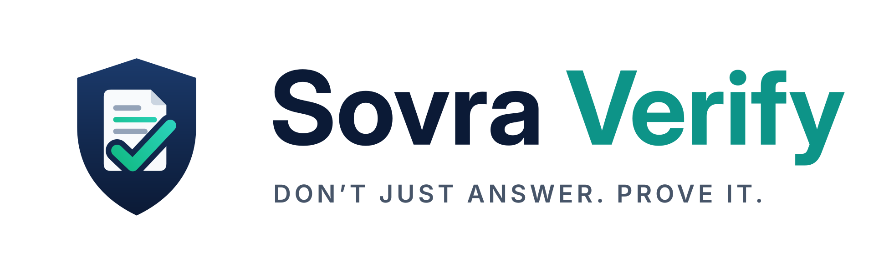
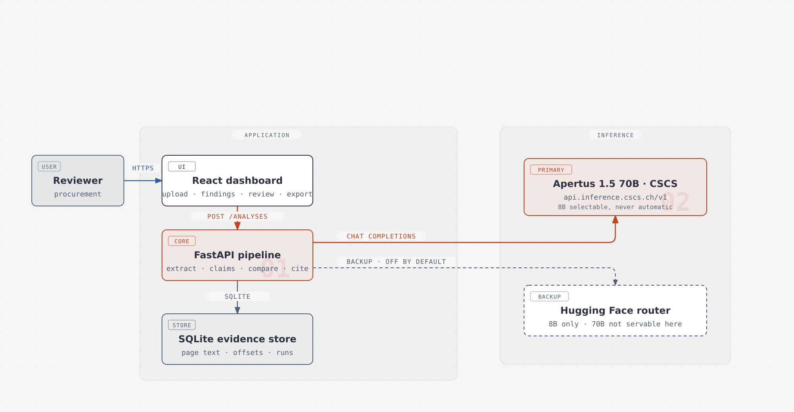

<p align="center">
  
</p>

<h1 align="center">Sovra Verify — Don't Just Answer. Prove It.</h1>

<p align="center">
  A cross-document consistency auditor powered by <strong>Apertus 1.5 70B on CSCS</strong>.
  It flags <em>potential</em> inconsistencies across a document corpus and returns the exact
  passage, page and character offsets behind every result, for human review.
</p>

---

## What it does

Upload up to ten text-native documents (PDF or UTF-8 TXT). Sovra Verify hashes each original,
extracts canonical text with page and character provenance, identifies typed claims with Apertus,
compares bounded claim pairs, and resolves every citation deterministically against the canonical
text. A reviewer confirms or dismisses each finding, and the export carries the source hash, page,
offsets, model and review state.

It reports **potential** inconsistencies in the supplied corpus. It does not check external truth,
does not decide which document legally wins, and does not give legal or compliance advice. A
different effective date or a stated exception is treated as an explanation, not as a conflict.

A citation is never authored by the model. The model nominates a passage id and an offset pair;
the quote is sliced from canonical text by the application. A finding whose spans do not resolve is
rejected before it can reach the interface or a report.

## Architecture



Source: [`docs/diagrams/architecture.html`](docs/diagrams/architecture.html) (diagram drawn with
[cathrynlavery/diagram-design](https://github.com/cathrynlavery/diagram-design)), exported to
[`architecture.svg`](docs/diagrams/architecture.svg) and `architecture.png`.

## Provider configuration

| Setting | Value |
|---|---|
| Primary provider | **CSCS**, `https://api.inference.cscs.ch/v1`, bearer auth, OpenAI-compatible |
| Default model | **`swiss-ai/Apertus-v1.5-70B`** |
| Backup provider | **Hugging Face** router, `https://router.huggingface.co/v1` |
| Backup model | `swiss-ai/Apertus-8B-Instruct-2509`, **off by default** |
| Optional 8B | `swiss-ai/Apertus-v1.5-8B`, selected only via `SOVRA_ALLOW_OPTIONAL_8B=1` |

The 70B model is never silently replaced by an 8B model. If the configured model cannot be served,
the call fails visibly, the failure is recorded on the analysis, and the run is marked `failed` or
`partial` rather than returning a clean-looking empty result. Every provider call is recorded with
its provider, model, mode, latency, token usage and error class.

## Run it

```bash
make run          # documented entry point: Docker, app + API
make run-local    # host process instead
make test         # 234 unit, integration and end-to-end tests
make evaluate     # frozen evaluation corpus against real inference
make no-footer    # footer audit over source, build output, PDF pages and every route
make audit        # fails if a credential or a forbidden file could be published
```

Judges supply their own credentials. Set `CSCS_INFERENCE_API_KEY` in the environment, or run
`make run` on a host whose `~/.hermes/.env` already contains it — the launcher reads only the two
named application keys out of that file, never the whole file, and never prints a value.

## Measured evidence

Recorded from a real run on 2026-10-12 against CSCS with `swiss-ai/Apertus-v1.5-70B`:

| Measurement | Value |
|---|---|
| Analysis | `429df808d24f4433`, status `complete` |
| Documents | 4 synthetic (agreement, accounts payable policy, invoice, amendment) |
| Claims identified | 27 — 21 resolved to a validated source span, 6 left unresolved and shown as unresolved |
| Candidate pairs | 12 considered, 8 after deduplication, 8 compared (198 skipped, none dropped by the cap) |
| Findings | 8 — 6 `potential_conflict`, 1 `unrelated`, 1 `consistent` |
| Provider calls | 11 |
| Failed provider calls | 0 |
| Tokens | 13,892 total (9,645 prompt + 4,247 completion) |
| Provider latency | 68.9 s across the run |
| Citations resolving to an exact slice of canonical text | **all 16** (0 mismatches) |
| Models used | `cscs:swiss-ai/Apertus-v1.5-70B` only (no downgrade, no backup call) |

The full ledger, the document hashes and every citation offset are in
[`track_2b/data/evaluation/PROOF.json`](track_2b/data/evaluation/PROOF.json) with a readable
[`PROOF.md`](track_2b/data/evaluation/PROOF.md), written by `scripts/export_proof.py`.

The genuine conflict in the demo corpus — the agreement's 30-day payment term against the policy's
60-day settlement period under the same effective date of 2026-01-01 — is reported as a
`potential_conflict` with both spans resolved. The agreement also matches the invoice as
`consistent`, and one pair is reported `unrelated`.

Honest negatives from the same run: the expedited-freight clause (10 days) and the amendment
(45 days, effective 2026-05-01) were **also** reported as `potential_conflict`, and the amendment's
unchanged-terms sentence was reported once as `unrelated`. The exception clause is a stated exception
and the amendment carries a different effective date, so those conflict judgements are false
positives against the demo's intent. They are recorded as measured, not removed. One further
limitation from the same run: 6 of 27 claims could not be resolved to a validated span and are shown
as unresolved rather than quietly dropped.

Evaluation results are written to `track_2b/data/evaluation/RESULTS.json` by `make evaluate`, with a
confusion matrix, per-class precision/recall/F1, abstention rate, resolved-citation rate, latency and
tokens per case. Failed requests are counted separately from correct abstentions and the denominator
is every case in the corpus, never only the successes.

## Demonstration video

A two-minute narrated demo is at [`docs/demo/sovra-verify-demo.mp4`](docs/demo/sovra-verify-demo.mp4).
It was authored with [scosman/videowright](https://github.com/scosman/videowright); the project,
narration script, audio plan and voice note live under `videos/`.

Narration was generated with ElevenLabs. The brief asked for a British young female voice; the
British young female voices in the account are library voices that the free tier refuses through the
API (HTTP 402 `paid_plan_required`), and voice design is paid-plan only (HTTP 403
`feature_not_available`). No additional spend was authorised, so the closest usable premade voice
was used instead — Alice, British and female — and the deviation is recorded in
`videos/videos/sovra_demo/audio/originals/voiceovers/alice-uk-v1/audio_meta.json`.

## Provider verification

Both credentials were re-verified with real inference on 2026-10-12 (`make verify-providers`, exit 0):

| Check | Result |
|---|---|
| CSCS `GET /models` | HTTP 200, 11 models, 324 ms |
| `swiss-ai/Apertus-v1.5-70B` reachable | yes — a real completion returned in 441 ms |
| CSCS smoke pair | `potential_conflict` with 2 resolved citations |
| `swiss-ai/Apertus-v1.5-8B` reachable | listed on the key (optional, never selected by default) |
| Hugging Face router `GET /models` | HTTP 200, 124 models, 86 ms (the count moves as the router changes) |
| Hugging Face `swiss-ai/Apertus-8B-Instruct-2509` | yes — a real completion returned in 1,218 ms |
| Apertus 1.5 70B on the Hugging Face router | **not servable** — its upstream mapping reports `status: "error"` |

So both credentials work, but the backup cannot stand in for the 70B default: the router serves only
the 8B instruct model, not Apertus 1.5 70B. The backup is therefore disabled by default, and
switching to it requires both `SOVRA_BACKUP_ENABLED=1` and `SOVRA_ALLOW_BACKUP_FALLBACK=1`, with the
model change recorded on the run.

The full recorded responses are in `track_2b/data/evaluation/PROVIDER_VERIFICATION.json`.

## Deployment honesty

The first verified mode is **a local application calling CSCS-hosted inference**. That is
external-network inference: a local web app that calls CSCS is not air-gapped, and Swiss inference
residency does not establish residency of the whole application. Application logs, storage, exports
and any third-party hosting remain the operator's responsibility. A configurable on-premise Apertus
endpoint exists in the provider layer but has not been tested against a real on-premise deployment,
so an on-premise, full Swiss-cloud or air-gapped claim is not made here.

Do not send sensitive real documents to any provider without authorisation and an appropriate data
review.

## Repository layout

```text
track_2b/
  backend/sovra/      config, models, ingest, citations, claims, compare, providers, storage, api
  frontend/           React + TypeScript dashboard (upload, findings, evidence, review, export)
  data/demo/          synthetic demo corpus
  data/evaluation/    frozen labelled evaluation corpus and measured results
  tests/              unit, integration and end-to-end tests
docs/                 progress log, evaluation, deployment, project story, built-with, diagrams
scripts/              launch, smoke, provider verification, evaluation, proof export, footer audit
videos/               videowright project for the demonstration video
```

## Documentation

- [`docs/PROGRESS.md`](docs/PROGRESS.md) — append-only checkpoint log with commands and results
- [`docs/PROVIDER_VERIFICATION.md`](docs/PROVIDER_VERIFICATION.md) — recorded provider evidence
- [`docs/EVALUATION.md`](docs/EVALUATION.md) — evaluation method, counts and limitations
- [`docs/DEPLOYMENT.md`](docs/DEPLOYMENT.md) — deployment modes, secrets handling and cost notes
- [`docs/DEVPOST_PROJECT_STORY.md`](docs/DEVPOST_PROJECT_STORY.md) — the seven-heading project story
- [`docs/BUILT_WITH.md`](docs/BUILT_WITH.md) — the technologies actually used
- [`track_2b/technical_report.md`](track_2b/technical_report.md) — the technical report, rendered to
  [`track_2b/technical_report.pdf`](track_2b/technical_report.pdf), four body pages plus references
- [`track_2b/data/evaluation/PROOF.md`](track_2b/data/evaluation/PROOF.md) — the delivered run's evidence bundle

## No footer, anywhere

No screen, export, report or PDF carries a footer, a copyright bar, an attribution strip, a
"powered by" line or a closing signature. Safety and prototype information sits next to the controls
it applies to. `make no-footer` scans the source, the built frontend, generated reports and exports,
every served route and every page of the rendered report PDF, and fails the build if a footer marker
appears. Licensing and provenance live in dedicated files, not in a footer.

## Secrets never ship

`make audit` compares the publishable tree against the real credential values, refuses `.env` and
key-shaped files, and opens every archive in the tree to scan its members. `scripts/package_submission.py`
builds the submission archive from exactly that publishable set, refuses to pack a flagged file, and
re-audits the archive after writing it. The developer's credential file is never copied, mounted or
packaged: `scripts/launch.sh` reads only the two named application entries and passes the variable
name, never the value, to Docker.
